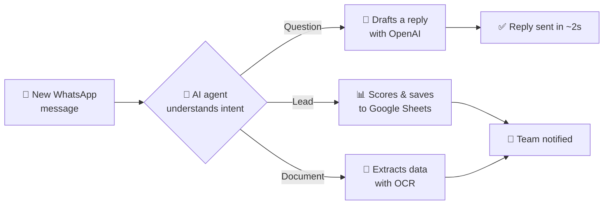

## Hey There, I'm Towhid Hasan 👋
<p align="left">
  <a href="https://towhid.dev"></a>
  <a href="https://www.linkedin.com/in/csetowhid"></a>
  <a href="https://wa.me/8801982525844"></a>
  <a href="mailto:towhidhasang1@gmail.com"></a>
  <a href="https://x.com/csetowhid"></a>
  <a href="https://www.facebook.com/csetowhid"></a>
</p>
<hr/>

<a href="https://towhid.dev">
  
</a>

> **I automate the busywork so your team can focus on real work.**

I'm an **AI Automation Engineer** who turns slow, manual processes into workflows that run on their own. I design and build systems that take repetitive work off people's plates: **chatbots** that answer customers on WhatsApp and Messenger in seconds, **AI document pipelines** that read emails, PDFs and scanned files and turn them into clean data, **lead generation agents** that find, score and deliver qualified prospects, and **integrations** that keep CRMs, spreadsheets and business apps in sync without anyone copying and pasting.

My toolkit spans **n8n, Make.com, Zapier and GoHighLevel** for orchestration, and **OpenAI, Claude, Gemini and LangChain** for the intelligence layer. What sets my work apart is what sits underneath: **4+ years of backend engineering in Laravel**. I've designed REST APIs, data models, queues and real-time features for production apps, so the automations I ship are built on clean APIs, sensible error handling and data you can trust, not fragile scripts that break the first time something unexpected happens.

I've also spent two years on the quality side, leading QA for an AI document-processing SaaS used by hospitals, insurers and law firms. That taught me to test AI workflows end to end and think through the edge cases before your customers find them. 🚀


| 📌 At a glance | |
|---|---|
| 🧑‍💻 **Role** | AI Automation Engineer |
| 🎯 **Focus** | AI chatbots & workflow automation |
| 🛠️ **Experience** | 4+ years (backend → AI automation) |
| 🟢 **Status** | Open to projects & consulting |

<br clear="right"/>

## ⚡ What I Can Automate For You

| | Service | What you get |
|:---:|---|---|
| 💬 | **AI Chatbots** | WhatsApp and Messenger bots that understand the message, draft a reply with AI and send it in seconds |
| 📄 | **Document Processing** | Emails, PDFs and scans go through OCR → extraction → classification → export to your sheets or cloud storage |
| 🎯 | **Lead Generation** | Scrape leads, filter out the junk, score each one with an AI agent and drop the qualified ones into a spreadsheet |
| 🔗 | **App Integrations** | n8n, Zapier and Make workflows that move data between your tools with no copy-paste |
| 🧩 | **Backend & APIs** | Laravel REST APIs, queues and databases that your automations can rely on |

### 🔄 A typical workflow I build



## 🛠️ Tech Stack

**🤖 AI & Automation**

<p align="left">
  
  
  
  
  
  
  
  
  
  
</p>

**💬 Messaging & Integrations**

<p align="left">
  
  
  
  
  
</p>

**⚙️ Backend & Web**

<p align="left">
  
  
  
  
  
  
  
</p>

**🧰 Tools**

<p align="left">
  
  
  
  
</p>

## 🚀 Featured Work

| Project | What it does | Stack |
|---|---|---|
| 🎯 **AI Lead Generation Pipeline** | Finds business leads, drops incomplete ones, scores each with an AI agent, and saves the qualified ones to a spreadsheet. | n8n · Apify · Gemini · Google Sheets |
| 💬 **WhatsApp & Messenger Auto-Replies** | AI drafts and sends replies to incoming messages in seconds, with edge cases covered. | WhatsApp API · Messenger API · OpenAI |
| 📄 **AI Data-Entry Agents (SaaS)** | No-code platform where users create an AI agent just by describing what to extract. Documents come in by email, photo, scan or API; AI reads, classifies and extracts the data, users review it, then it's exported to Google Drive, OneDrive or 6,000+ apps via Zapier. Used by hospitals, insurers and law firms. *My role: led QA end to end.* | AI · OCR + NLP · Zapier · Google Drive · OneDrive |
| 🛵 **Food Delivery Platform** | REST APIs for ordering, restaurants and delivery, plus live rider tracking on Google Maps. | Laravel · Vue.js · MySQL |

👉 More projects on **[towhid.dev](https://towhid.dev/#projects)**

## 🧭 How I Work

| 01 · Design the system | 02 · Build for reliability | 03 · Automate the work |
|---|---|---|
| Clear architecture, clean APIs and data models that stay maintainable as the product grows. | Queues, caching, tests and monitoring that keep everyday operations dependable. | AI workflows and integrations that remove repetitive steps and give teams time back. |

## 💼 Experience

```
2026 ─ now   🤖  AI Automation Engineer · Freelance / Open to projects
2024 ─ 2026  🧪  QA Engineer, AI Automation · CodeShaper (Remote)
2021 ─ 2024  ⚙️  Backend Engineer · CodeMen
2021         🌱  Web Developer Intern · ApitSoft
```

- **CodeShaper:** led QA for an AI document-processing platform, tested WhatsApp and Messenger reply automations, and built Zapier syncs from Excel into connected apps.
- **CodeMen:** designed the Laravel REST APIs behind a food delivery app, including real-time rider tracking on Google Maps.
- **ApitSoft:** built CMS modules and shipped fixes for client websites.

🎓 **B.Sc. in Computer Science & Engineering**, North Western University, Khulna

## 📊 GitHub Stats

<p align="center">
  
  
</p>

---

<p align="center">
  <b>🤝 Need something automated?</b><br/>
  Email <a href="mailto:towhidhasang1@gmail.com">towhidhasang1@gmail.com</a> · message me on <a href="https://wa.me/8801982525844">WhatsApp</a> · or visit <a href="https://towhid.dev">towhid.dev</a><br/><br/>
  
</p>
